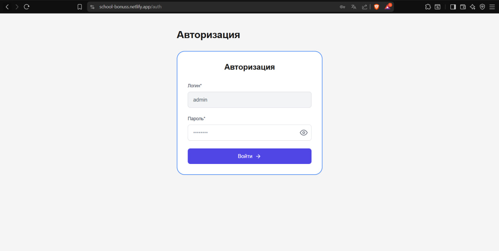
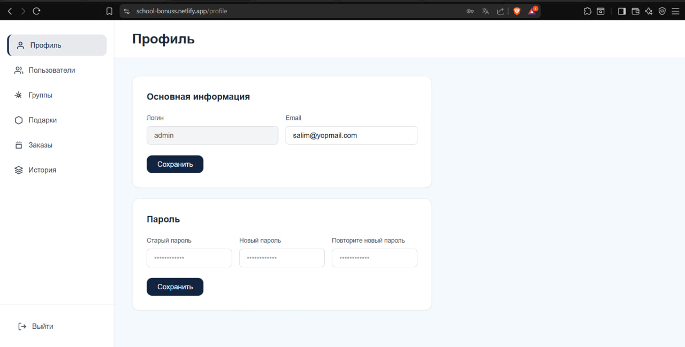
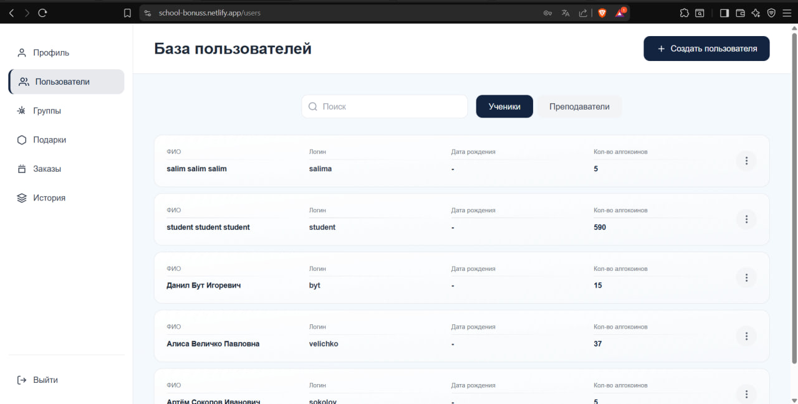
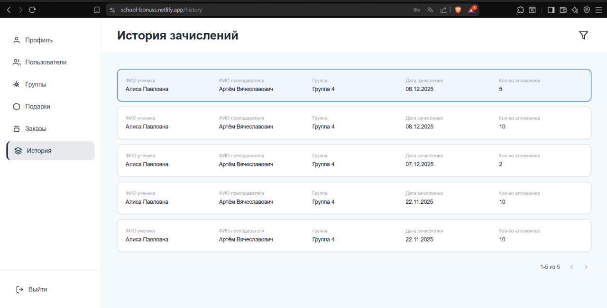
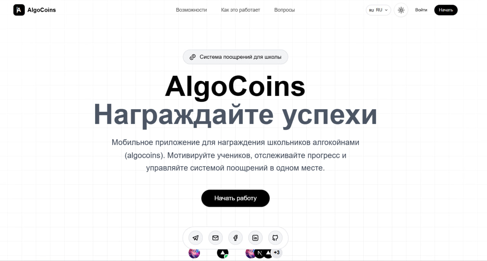
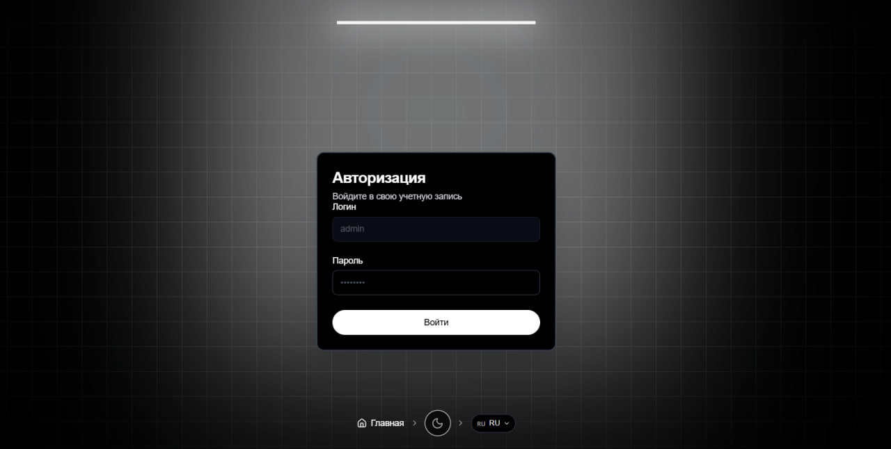
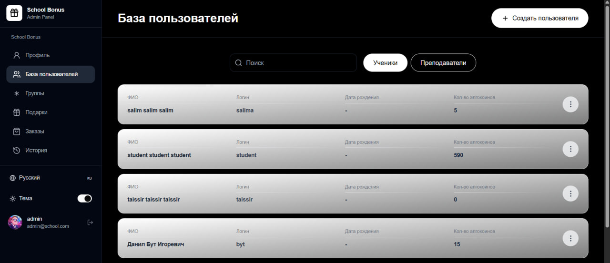
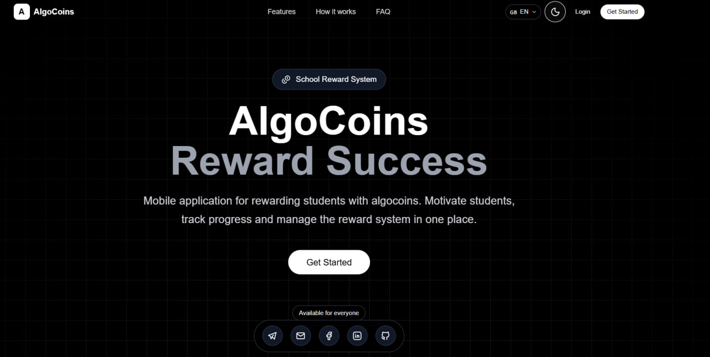

<div align="center">

# 🎓 School Bonus Application (AlgoCoins)

### Mobile Application for Awarding Bonuses (AlgoCoins) to School Students

<div>
  
  
  
  
  
  
  
  
</div>

<br/>

**Modern school bonus management system with AI-powered features, multi-language support, and beautiful animated UI. Manage students, groups, gifts, and bonus distributions efficiently.**

</div>

---

---

## � Key Features

<div align="center">
  <table>
    <tr>
      <td align="center" width="33%">
        <h3>🔐 Smart Authentication</h3>
        <p>Secure admin login with animated lamp effect and modern UI</p>
      </td>
      <td align="center" width="33%">
        <h3>🌍 Multi-Language</h3>
        <p>Full support for English, Russian, and French languages</p>
      </td>
      <td align="center" width="33%">
        <h3>🎨 Dark/Light Mode</h3>
        <p>Beautiful themes with smooth transitions and animations</p>
      </td>
    </tr>
    <tr>
      <td align="center" width="33%">
        <h3>👥 User Management</h3>
        <p>Complete CRUD operations for students and administrators</p>
      </td>
      <td align="center" width="33%">
        <h3>🎁 Bonus System</h3>
        <p>Manage AlgoCoins distribution and gift redemption</p>
      </td>
      <td align="center" width="33%">
        <h3>📊 Analytics</h3>
        <p>Track history and monitor bonus activities</p>
      </td>
    </tr>
  </table>
</div>

---

## �📸 Project Evolution

This project has been refined twice with significant UI/UX improvements:

### 🗂️ Version 1 (Old Frontend - school-bonus-app01)
<div align="center">
  <table>
    <tr>
      <td width="50%">
        
        <p align="center"><b>Login Page</b></p>
      </td>
      <td width="50%">
        
        <p align="center"><b>Dashboard</b></p>
      </td>
    </tr>
    <tr>
      <td width="50%">
        
        <p align="center"><b>Profile Page</b></p>
      </td>
      <td width="50%">
        
        <p align="center"><b>Settings</b></p>
      </td>
    </tr>
  </table>
</div>

### ✨ Version 2 (New Frontend - school-bonus-app02)
<div align="center">
  <table>
    <tr>
      <td width="50%">
        
        <p align="center"><b>Modern Landing Page</b></p>
      </td>
      <td width="50%">
        
        <p align="center"><b>Animated Login with Lamp Effect</b></p>
      </td>
    </tr>
    <tr>
      <td width="50%">
        
        <p align="center"><b>Enhanced Dashboard</b></p>
      </td>
      <td width="50%">
        
        <p align="center"><b>Glowing Features Grid</b></p>
      </td>
    </tr>
  </table>
</div>

---

## 📌 Версии проекта

### Version 1.0 - Initial Release
**Основная функциональность:**
- ✅ Система авторизации (admin login)
- ✅ Профиль пользователя с редактированием email
- ✅ Смена пароля с валидацией
- ✅ Боковое меню навигации
- ✅ Интеграция с Backend API
- ✅ Proxy сервер для обхода CORS
- ✅ Базовый минималистичный UI


### Version 2.0 - Multi-language & Enhanced UI ✨
**Новые возможности:**
- ✨ **Мультиязычность** - Поддержка English, Русский, Français
- ✨ **Лендинг страница** - Красивая главная страница с:
  - Hero секция с масштабированием 110%
  - Infinite scrolling карточки с отзывами
  - Glowing features сетка
  - FAQ секция с аккордеоном
  - Floating dock социальных сетей
- ✨ **Lamp эффект** - Анимированная подсветка на странице авторизации с плавным свечением
- ✨ **Resizable Navbar** - Адаптивная навигация со scroll анимацией (70% width при скролле)
- ✨ **Dark Mode** - Полная поддержка светлой/темной темы
- ✨ **Grid Background** - Стильный фон с сеткой на всех страницах
- ✨ **Language Switcher** - Компактная кнопка переключения языков с флагами
- ✨ **Улучшенные UI компоненты** - shadcn/ui библиотека (Card, Button, Input, Label, Avatar, Breadcrumb)
- ✨ **Framer Motion** - Плавные анимации и transitions

**Технические улучшения:**
- Централизованная система переводов (`lib/translations.ts`)
- Компонент `LanguageSwitcher` с поддержкой вверх/вниз dropdown
- `LampContainer` с flowing animations и conic gradients
- Оптимизированный navbar с spring animations
- Theme provider для dark/light режимов


## Технологический стек

### Core
- **Next.js 15** - React фреймворк
- **React 19** - UI библиотека
- **TypeScript** - Типизация
- **Tailwind CSS v3.4** - Стилизация
- **Express.js** - Proxy сервер для решения CORS

### UI & Animations
- **Framer Motion** - Анимации и transitions
- **shadcn/ui** - UI компоненты библиотека
- **Radix UI** - Примитивы компонентов (Avatar, Label, Slot)
- **Tabler Icons** - Иконки
- **Lucide React** - Дополнительные иконки
- **next-themes** - Dark/Light режим

### Libraries
- **class-variance-authority** - CVA для вариантов компонентов
- **clsx & tailwind-merge** - Утилиты для className
- **@tabler/icons-react** - Набор иконок

### Backend
- **Backend API** - http://212.220.105.29:8079

## Архитектура

Приложение использует proxy-сервер для обхода CORS ограничений:

```
Frontend (Next.js)     Proxy Server (Express)     Backend API
localhost:3000    -->  localhost:3001        -->  212.220.105.29:8079
```

## Структура проекта

```
├── app/
│   ├── auth/              # Страница авторизации (с Lamp эффектом)
│   ├── profile/           # Страница профиля
│   ├── users/             # Страница управления пользователями
│   ├── groups/            # Страница управления группами
│   ├── gifts/             # Страница управления подарками
│   ├── orders/            # Страница заказов
│   ├── history/           # История операций
│   ├── not-found.tsx      # 404 страница
│   ├── layout.tsx         # Основной layout с ThemeProvider
│   ├── page.tsx           # Главная страница (Landing)
│   └── globals.css        # Глобальные стили
├── components/
│   ├── ui/                # shadcn/ui компоненты
│   │   ├── lamp.tsx       # Lamp эффект с анимацией
│   │   ├── resizable-navbar.tsx  # Адаптивная навигация
│   │   ├── grid-background.tsx   # Фон с сеткой
│   │   ├── infinite-moving-cards.tsx  # Бесконечный скролл
│   │   ├── glowing-effect.tsx    # Эффект свечения
│   │   ├── card.tsx       # Card компонент
│   │   ├── button.tsx     # Button компонент
│   │   ├── input.tsx      # Input компонент
│   │   ├── label.tsx      # Label компонент
│   │   ├── avatar.tsx     # Avatar компонент
│   │   ├── breadcrumb.tsx # Breadcrumb навигация
│   │   ├── floating-dock.tsx  # Плавающий dock
│   │   └── ...
│   ├── language-switcher.tsx    # Переключатель языков
│   ├── theme-toggle.tsx         # Переключатель темы
│   ├── theme-provider.tsx       # Провайдер темы
│   ├── resizable-navbar-demo.tsx  # Навигация
│   ├── social-footer.tsx        # Футер с соцсетями
│   └── glowing-features-demo.tsx # Сетка возможностей
├── lib/
│   ├── api.ts             # API клиент
│   ├── types.ts           # TypeScript типы
│   ├── utils.ts           # Утилиты (cn)
│   └── translations.ts    # Система переводов (EN/RU/FR)
├── .github/
│   └── copilot-instructions.md  # Инструкции для Copilot
├── server.js              # Express proxy сервер
├── netlify.toml           # Netlify конфигурация
└── package.json
```

## Функциональность

### Главная страница (`/`) - 🆕 Version 2.0
- **Hero секция** с 110% масштабированием для выразительности
- **Адаптивная навигация** с анимацией при скролле (70% width)
- **Переключатель языков** - EN 🇬🇧 / RU 🇷🇺 / FR 🇫🇷
- **Переключатель темы** - Light/Dark режимы
- **Infinite Moving Cards** - Бесконечно прокручивающиеся отзывы
- **Glowing Features Grid** - Сетка возможностей со свечением
- **FAQ секция** - Аккордеон с частыми вопросами
- **Floating Social Dock** - Плавающая панель социальных сетей
- **Grid Background** - Стильный фон с анимированной сеткой

### Страница авторизации (`/auth`)
- Логин: "admin" (поле неактивное, изменить нельзя)
- Поле ввода пароля с возможностью показа/скрытия
- Кнопка "Войти" с переходом на страницу профиля
- **🆕 Lamp эффект** - Анимированная подсветка с flowing animations
- **🆕 Breadcrumb навигация** - Home / Theme / Language в нижней части
- **🆕 Мультиязычность** - Все тексты на выбранном языке

### Страница профиля (`/profile`)
- Боковое меню навигации:
  - Профиль (активная)
  - Пользователи
  - Группы
  - Подарки
  - Заказы
  - История
  - Выйти

- **Основная информация:**
  - Логин: "admin" (неактивное поле)
  - Email: можно редактировать
  - Валидация email: формат xxx@xxx.xx
  - Кнопка "Сохранить" для email

- **Смена пароля:**
  - Старый пароль
  - Новый пароль
  - Повторите новый пароль
  - Валидация:
    - Новый пароль и повтор должны совпадать
    - Старый пароль должен быть верным
  - Сообщения об ошибках на русском языке

## Установка и запуск

1. Установите зависимости:
```bash
npm install
```

2. Создайте файл `.env.local` (опционально, уже настроен):
```bash
NEXT_PUBLIC_API_URL=http://localhost:3001/api
```

3. Запустите приложение с proxy сервером:

**Вариант 1: Запуск всего сразу (рекомендуется)**
```bash
npm run dev:all
```

**Вариант 2: Запуск вручную в двух терминалах**

Терминал 1 - Proxy сервер:
```bash
npm run proxy
```

Терминал 2 - Next.js:
```bash
npm run dev
```

4. Откройте браузер по адресу [http://localhost:3000](http://localhost:3000)

## 🔄 Переключение между версиями

Проект имеет теги для каждой версии:

```bash
# Посмотреть все версии
git tag

# Переключиться на Version 1.0
git checkout v1.0

# Переключиться на Version 2.0 (latest)
git checkout v2.0

# Вернуться на master (latest development)
git checkout master
```

### Проверка работы proxy сервера

Откройте [http://localhost:3001/health](http://localhost:3001/health) - должен вернуться JSON с информацией о сервере.

## Команды

- `npm run dev` - Запуск только Next.js dev сервера
- `npm run proxy` - Запуск только proxy сервера
- `npm run dev:all` - Запуск Next.js + Proxy одновременно (рекомендуется)
- `npm run build` - Сборка для production
- `npm start` - Запуск production сервера
- `npm run lint` - Проверка кода

## API Integration

### Доступные endpoints

Все запросы проходят через proxy на `http://localhost:3001/api`:

**Users:**
- `GET /api/users/me` - Получить текущего пользователя
- `GET /api/users/{id}` - Получить пользователя по ID
- `POST /api/users` - Создать пользователя
- `PUT /api/users/{id}` - Обновить пользователя
- `DELETE /api/users/{id}` - Удалить пользователя

**Groups:**
- `GET /api/groups` - Получить группы
- `GET /api/groups/{id}` - Получить группу по ID
- `POST /api/groups` - Создать группу
- `PUT /api/groups/{id}` - Обновить группу
- `DELETE /api/groups/{id}` - Удалить группу
- `POST /api/groups/{groupId}/students/{studentId}` - Добавить студента
- `DELETE /api/groups/{groupId}/students/{studentId}` - Удалить студента

**Presents (Подарки):**
- `GET /api/presents` - Получить подарки
- `GET /api/presents/{id}` - Получить подарок по ID
- `GET /api/presents/search?query=xxx` - Поиск подарков
- `POST /api/presents` - Создать подарок
- `PUT /api/presents/{id}` - Обновить подарок
- `DELETE /api/presents/{id}` - Удалить подарок
- `POST /api/presents/{id}/photos` - Добавить фото
- `DELETE /api/presents/{presentId}/photos/{photoId}` - Удалить фото

### Решение проблемы CORS

Proxy сервер (`server.js`) решает проблему CORS, перенаправляя все запросы к backend API и добавляя необходимые CORS заголовки.

**Как это работает:**
1. Frontend делает запрос на `http://localhost:3001/api/...`
2. Proxy сервер получает запрос и пересылает его на `http://212.220.105.29:8079/api/...`
3. Backend отвечает proxy серверу
4. Proxy сервер добавляет CORS заголовки и возвращает ответ frontend

## Требования к валидации

### Email
- Формат: `xxx@xxx.xx`
- Регулярное выражение: `/^[^\s@]+@[^\s@]+\.[^\s@]+$/`
- Сообщение об ошибке: "Неверный формат email. Используйте формат: xxx@xxx.xx"

### Пароль
- Если пароли не совпадают: "Пароли не совпадают, попробуйте снова"
- Если старый пароль неверный: "Старый пароль введен неверно, попробуйте снова"

## Следующие шаги

### ✅ Выполнено (v1.0 - v2.0)
- [x] Создание страницы авторизации
- [x] Создание страницы профиля
- [x] Подключение к backend API
- [x] Настройка proxy сервера для CORS
- [x] Валидация форм (email, пароль)
- [x] Мультиязычность (EN/RU/FR)
- [x] Dark/Light режимы
- [x] Адаптивная навигация с анимацией
- [x] Landing страница с современным UI
- [x] Lamp эффект на странице авторизации

### 🚧 В разработке
- [ ] Полная функциональность страницы "Пользователи"
- [ ] Полная функциональность страницы "Группы"
- [ ] Полная функциональность страницы "Подарки"
- [ ] Создание страницы "Заказы"
- [ ] Создание страницы "История"
- [ ] Расширенная авторизация (роли и права)
- [ ] Деплой на production сервер
- [ ] Мобильная оптимизация
- [ ] Unit тесты

## Дизайн

Дизайн в Figma: [Ссылка на макеты](https://www.figma.com/design/MIrRIIAMtPjC7O9oTe4lXU/%D0%9C%D0%BE%D0%B1%D0%B8%D0%BB%D1%8C%D0%BD%D0%BE%D0%B5-%D0%BF%D1%80%D0%B8%D0%BB%D0%BE%D0%B6%D0%B5%D0%BD%D0%B8%D0%B5-%D0%B4%D0%BB%D1%8F-%D1%83%D1%87%D0%B5%D0%BD%D0%B8%D0%BA%D0%BE%D0%B2?node-id=0-1&t=J5Tksb4CIysZXOxu-1)

## Паспорт проекта

- **Номер:** No2086/ЛКП-5610-2025
- **Дата:** 26.08.2025
- **Организация:** ООО "АКАДЕМИЯ ПРИКЛАДНОЙ ИНФОРМАТИКИ"
- **Период реализации:** 01.09.2025 - 31.01.2026
---

## 👨‍💻 Developer & Contact

<div align="center">

### Mohamed Salim Boussaid

<div style="margin: 20px 0;">
  <a href="https://github.com/salimboussaid" target="_blank">
    
  </a>
  <a href="https://www.linkedin.com/in/mohamed-salim-boussaid-1ba90a228/" target="_blank">
    
  </a>
  <a href="mailto:salimboussaid@mail.ru">
    
  </a>
</div>

**Developed with 💙 by Mohamed Salim Boussaid**

</div>

---

<div align="center">

### 🌟 Technologies & Frameworks Used

```
Frontend                Backend              UI/UX                    Tools
├─ Next.js 15          ├─ Node.js 20        ├─ Framer Motion        ├─ TypeScript
├─ React 19            ├─ Express.js        ├─ Tailwind CSS         ├─ Git
├─ TypeScript          ├─ MongoDB 7         ├─ shadcn/ui            ├─ npm
└─ Radix UI            └─ Prisma            └─ Lucide Icons         └─ VS Code
```

</div>

---

<div align="center">
  
**⭐ Star this repo if you find it helpful!**

Made with ❤️ in 2025-2026

</div>